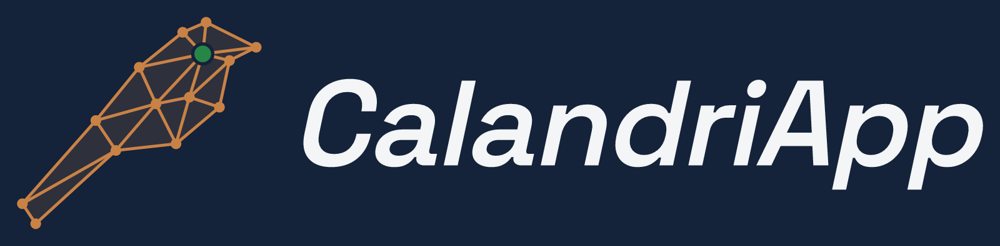
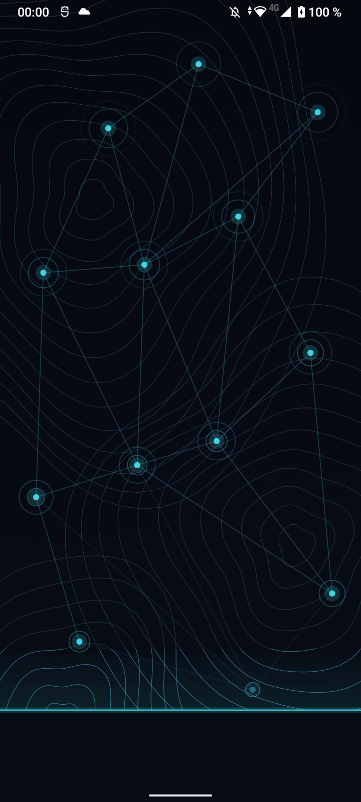
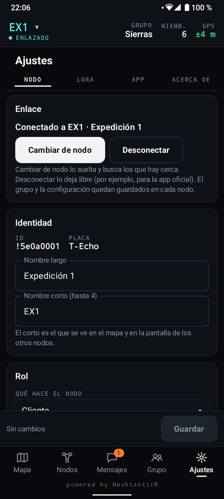
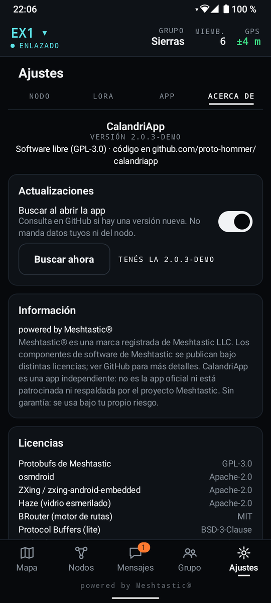

```
  ____     _     _         _     _   _  ____   ____   ___     _     ____   ____
 / ___|   / \   | |       / \   | \ | ||  _ \ |  _ \ |_ _|   / \   |  _ \ |  _ \
| |      / _ \  | |      / _ \  |  \| || | | || |_) | | |   / _ \  | |_) || |_) |
| |___  / ___ \ | |___  / ___ \ | |\  || |_| ||  _ <  | |  / ___ \ |  __/ |  __/
 \____|/_/   \_\|_____|/_/   \_\|_| \_||____/ |_| \_\|___|/_/   \_\|_|    |_|
```

CalandriApp
===========

**Una app Android chica y propia para usar nodos Meshtastic en el campo: mensajes, mapa offline y
seguimiento de un grupo cerrado, sin cuentas, sin nube y sin internet.**

Versión **1.4.0** | Android 8 o más nuevo | *powered by Meshtastic®*

[](https://github.com/proto-hommer/calandriapp/releases/latest)

<p align="center">
  
</p>

**Bajás el APK, lo instalás, emparejás tu nodo por Bluetooth y tenés a tu grupo en el mapa.**

<p align="center">
  
  &nbsp;
  
  &nbsp;
  
  &nbsp;
  
</p>
<p align="center"><i>La intro (los nodos sueltos se juntan y forman la calandria), los ajustes del nodo y el "acerca de".</i></p>

* * *

Qué es esto
-----------

CalandriApp habla con un nodo [Meshtastic](https://meshtastic.org) por Bluetooth y usa la API pública
de Meshtastic. **No es un fork de la app oficial**: es una app más simple, hecha para un uso concreto,
trabajo de campo con un grupo cerrado:

- **Mensajes** al grupo, al canal público y directos, con confirmación de entrega y reintento,
  respuestas a un mensaje concreto (mantenerlo apretado) y los saltos que dio cada uno.
- **Avisos de mensajes nuevos**: un cartel dentro de la app y notificaciones con la app cerrada o la
  pantalla apagada (la conexión sigue en segundo plano y se reconecta sola si se corta).
- **Mapa offline** con los nodos del grupo, su rastro y los waypoints (se crean con un toque largo
  y llegan los de los demás).
- **Colores que se leen de un vistazo**:
  - los del grupo, en verde, amarillo, naranja o rojo según los saltos;
  - los fijos del grupo (router, base), en azul;
  - los ajenos, con el nombre en violeta y un anillo con la señal;
  - los nodos fijos (router, base, repetidor), del grupo o ajenos, con forma de rombo;
  - los ajenos que no se oyen hace más de 30 minutos se ocultan del mapa hasta que vuelven a oírse.
- **Ir a un nodo o waypoint** sin salir de la app: la ruta por calles y senderos (a pie, en bici o
  en auto), lo que falta, el tiempo y el rumbo, que se recalcula si te salís del camino o si el nodo
  se mueve. Funciona **sin señal**: los datos de rutas de la zona se bajan una vez (Córdoba y
  alrededores, unos 11 MB). Sin esos datos, muestra la línea recta.
- **Alcance estimado**: con un toque largo sobre un nodo, si le cargaste los datos de la antena.
  La altura puede salir sola del GPS del nodo (su altitud menos el terreno), si la manda.
- **Perfil de terreno** entre vos y cualquier nodo: el corte del relieve, la línea de vista, la zona
  de Fresnel y si el enlace **pasa, está al límite o no pasa**, con el margen en dB. Usa el relieve
  del SRTM (≈30 m), que se baja por zonas y queda guardado para usarlo sin señal.
- **Mapas sin conexión por cuadrantes** (en Ajustes): una cuadrícula sobre el mapa (1-A, 2-B…)
  con lo bajado en verde, lo que se está bajando en amarillo y lo que falta en rojo. Se elige qué
  cuadrantes bajar y se baja todo junto: el relieve y, si la fuente lo permite, el mapa.
- **Grupo cerrado en dos toques**: crea un canal privado con clave AES-256 y lo comparte por QR
  (el formato estándar de Meshtastic, así que sirve también con la app oficial). El nombre del grupo
  se puede cambiar después (los demás vuelven a escanear el QR).
- **Posición del celular** al grupo a través del nodo, para nodos sin GPS.
- **Ajustes del nodo conectado**: nombre, rol, posición, radio, canales, reinicio.

La calandria es un pájaro cantor de acá. En el logo está dibujada como una malla de nodos
conectados, y el ojo es el nodo principal.

* * *

Por qué se hizo
---------------

Arrancó con el [Mesh Paper 1.54](https://github.com/proto-hommer/mesh-paper-154), un nodo
Meshtastic de bolsillo con pantalla e-paper. Ese nodo **no tiene GPS**: su posición la tiene que
mandar el celular. Y en el campo, lo que hacía falta era poco y concreto:

- saber **dónde está cada uno del grupo** y si se lo está oyendo bien;
- **mandarse mensajes** sin depender de la señal del celular;
- tener el **mapa sin internet**;
- que los nodos de afuera sirvan **solo de repetidores**, sin mezclarse con el grupo.

La app oficial hace muchísimo más, pero para esto sobraba. CalandriApp hace eso, de forma simple y
sin cuentas, sin nube ni servicios de Google: todo queda en el teléfono.

**Es libre y gratis: la puede bajar y usar el que quiera**, con su propio nodo y su propio grupo.

* * *

Descargar e instalar
--------------------

1. Bajá el `CalandriApp-1.4.0.apk` de la [última versión](https://github.com/proto-hommer/calandriapp/releases/latest).
2. Abrilo en el celular. Android va a pedir permiso para **instalar apps de origen desconocido**:
   dáselo al navegador o al gestor de archivos con el que lo abriste.
3. Abrí CalandriApp, dale los permisos de **Bluetooth** y **ubicación**, tocá **BUSCAR** y
   **EMPAREJAR** tu nodo. El PIN por defecto es `123456`, o el que muestre la pantalla del nodo.
4. En **Grupo**, creá un grupo nuevo o escaneá el QR de alguien que ya lo tenga.

La próxima vez se conecta sola al último nodo.

**Si no aparece el nodo:** en Android 8 a 11 hay que tener **prendida la ubicación** del teléfono para
buscar por Bluetooth (la app avisa). Y el nodo no se anuncia mientras está conectado a otra app, como
la oficial de Meshtastic: cerrala o desconectalo de ahí. Si ya lo emparejaste desde los ajustes de
Android, aparece igual en la lista con el botón CONECTAR.

### Con qué nodos anda

Con **cualquier nodo Meshtastic que tenga Bluetooth**: Heltec, LilyGO (T-Beam, T-Echo, T-Deck),
RAK, Seeed, ThinkNode, Station G2 y el resto de los 154 modelos que conoce Meshtastic, en
cualquier región. Conviene firmware **2.5 o más nuevo**: la app avisa si el del nodo es más viejo.

Probada en un Motorola moto e22 (Android 12) conectada a un nodo Seeed XIAO ESP32-S3 + Wio-SX1262,
con un Mesh Paper 1.54 en el grupo, en la región ANZ (Argentina).

Por ahora **solo por Bluetooth**: los nodos que solo se conectan por WiFi o USB (por ejemplo, con
RP2040 o `meshtasticd` en Linux) todavía no.

* * *

El grupo cerrado
----------------

La app arma el grupo como lo recomienda la documentación de Meshtastic:

- **Canal principal = privado del grupo**, con clave AES-256 aleatoria. La posición y la telemetría
  salen por ahí, cifradas.
- **Secundario = canal público** (LongFast), para hablar con gente de afuera.
- **Slot de frecuencia fijo** (el 20 en ANZ con LongFast), para que los nodos públicos nos sigan
  oyendo y repitiendo aunque el canal principal tenga otro nombre.
- Se comparte con la **URL / QR estándar de Meshtastic**: cada miembro puede usar esta app o la oficial.

Un nodo cuenta como **del grupo** cuando alguna vez se lo oyó por el canal privado, es decir, cuando
tiene la clave. Los demás se muestran como repetidores.

* * *

Cómo se hizo
------------

Por etapas, compilando y probando cada una en un teléfono real antes de pasar a la siguiente:

1. **Bluetooth**: conectar, emparejar con PIN, leer la configuración y listar los nodos.
2. **Grupo**: crear el canal privado con el slot fijado, compartirlo y unirse por QR.
3. **Mensajes** de canal y directos, con confirmación de entrega y reintento.
4. **Posición del celular** al nodo, periódica y por el canal privado.
5. **Mapa offline** con osmdroid: nodos del grupo con su rastro y waypoints.

Después vinieron:

- la interfaz tipo HUD, con el mapa como pantalla principal;
- los colores por saltos y el anillo de señal de los nodos ajenos;
- la pestaña de ajustes del nodo y el estimador de alcance;
- el soporte de todas las regiones y placas;
- la marca, con el ícono adaptativo y la intro animada;
- el aspecto neón, con paneles de vidrio esmerilado sobre el mapa.

Algunas cosas que salieron en el camino:

- **El canal 0 no siempre es "el grupo".** El nodo deja en canal 0 a los nodos de los que nunca
  recibió el nombre, y los mensajes directos cifrados con clave pública también llegan con canal 0.
  Por eso la app solo cuenta como del grupo a quien se oyó por el canal privado de verdad.
- **El mapa respeta las reglas de OpenStreetMap**: muestra su atribución, respeta la caché de sus
  servidores y no baja zonas enteras de ellos. Para usarlo sin conexión, se importa un `.mbtiles` o
  se pone un servidor de mapas propio.
- **La marca se genera sola**: el ícono en todas las densidades, el monocromo de Android 13, los
  logos y la geometría de la intro salen de un único `marca.svg`, con un script
  (ver [`assets/brand/README.md`](assets/brand/README.md)).

* * *

Privacidad
----------

- Sin cuentas, sin nube, sin Google Play Services, sin analíticas.
- Los mensajes, rastros, waypoints y datos de antenas quedan **solo en el teléfono**.
- La ubicación del celular se usa para el mapa y, si lo dejás prendido, para pasársela al nodo, que
  la manda **cifrada por el canal privado del grupo**.
- Lo único que sale a internet son los tiles del mapa y del relieve, si tenés "usar internet" prendido,
  los datos de rutas de una zona cuando los pedís (de brouter.de: el servidor solo sabe qué cuadro de
  5° bajaste), y, al abrir la app, una consulta a GitHub para ver si hay una versión nueva (se apaga en
  Ajustes → Actualizaciones). Las actualizaciones se bajan de los releases de este repo y solo se
  instalan si están firmadas con el mismo certificado y coinciden con su SHA-256.

* * *

Lo que viene
------------

- Conexión por **WiFi** y por **USB**, para nodos sin Bluetooth.
- Paleta de la marca (cobre y verde) en toda la interfaz.
- Alcance según el terreno: en vez de un círculo, la zona que cubre un nodo y la que queda en
  sombra detrás de los cerros.

* * *

Compilar desde el código
------------------------

Hace falta Android Studio, o su JDK, y el submódulo de los protobufs de Meshtastic:

```
git clone --recurse-submodules https://github.com/proto-hommer/calandriapp.git
cd calandriapp
./gradlew assembleDebug
```

El APK queda en `app/build/outputs/apk/debug/`. Para una versión de publicación firmada con tu propia
clave, ver el comentario sobre la firma en `app/build.gradle.kts`.

* * *

Créditos, marcas y licencias
----------------------------

- **powered by Meshtastic®.** Meshtastic® es una marca registrada de Meshtastic LLC. Los componentes de
  software de Meshtastic se publican bajo distintas licencias; ver [GitHub](https://github.com/meshtastic)
  para más detalles. CalandriApp es una app independiente: **no es la app oficial ni está patrocinada
  ni respaldada por el proyecto Meshtastic**. Sin garantía: se usa bajo tu propio riesgo.
- Datos del mapa © colaboradores de [OpenStreetMap](https://www.openstreetmap.org/copyright),
  disponibles bajo la licencia ODbL.
- Rutas calculadas en el teléfono con [BRouter](https://github.com/abrensch/brouter) (MIT), con datos
  de OpenStreetMap preparados por brouter.de.
- Relieve: SRTM, cortesía del U.S. Geological Survey, a través de
  [Terrain Tiles](https://registry.opendata.aws/terrain-tiles/) (AWS Open Data, Mapzen / Tilezen).
- Usa los [protobufs de Meshtastic](https://github.com/meshtastic/protobufs) (GPL-3.0),
  [osmdroid](https://github.com/osmdroid/osmdroid), [ZXing](https://github.com/zxing/zxing) y
  [zxing-android-embedded](https://github.com/journeyapps/zxing-android-embedded) (Apache-2.0),
  [Haze](https://github.com/chrisbanes/haze) (Apache-2.0),
  Protocol Buffers (BSD-3-Clause), AndroidX / Jetpack Compose y Kotlin (Apache-2.0). El logo usa
  la tipografía Space Grotesk (OFL-1.1).

Licencia
--------

CalandriApp es software libre bajo la **[GNU GPL v3](LICENSE)**: la podés usar, estudiar, compartir
y modificar, siempre que lo que distribuyas también sea libre y con su código.
